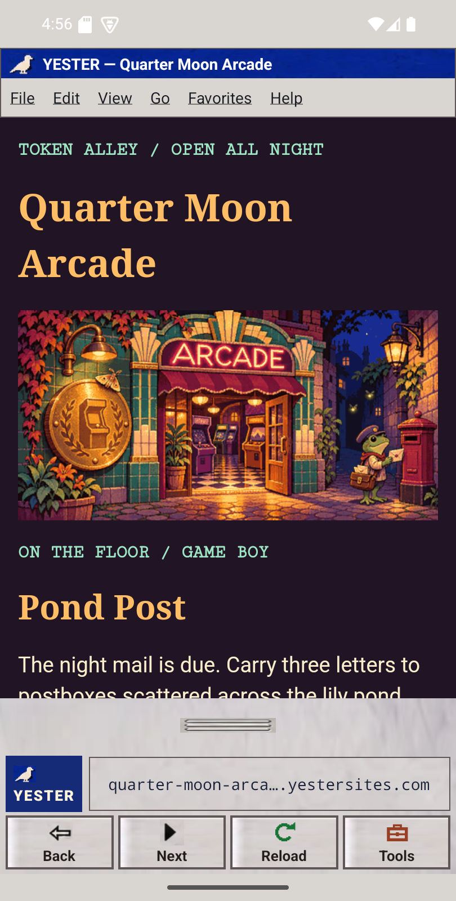
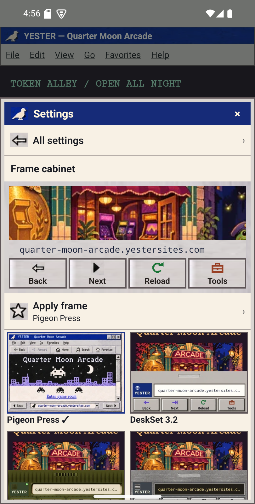

# YESTER by RODDY

**[Download YESTER 0.2.8 for Android (.apk)](https://github.com/lionsarmor/yester/releases/download/v0.2.8/YESTER-0.2.8.apk)**

Open this page on your Android phone or tablet, download the APK, and tap it in Files to install. The signed preview runs on Android 7 and later and includes 32-bit and 64-bit builds for ARM and Intel. Flick the ribbed grip up to visit another site. Pull slowly to open the toolbar. Choose Shuffle, Games, or Follow a ring, or open Library to follow a webmaster’s updates. The feed needs an internet connection.

Try the [interactive Android preview](https://android.yestersites.com/) to explore the 15 browser frames. Compare the [design boards](outputs/yester-mobile/design-review) with the [frames photographed in the Android emulator](outputs/yester-mobile/review/frame-cabinet.jpg).

## Screenshots

[Compare the four page actions in all twelve neighborhood frames](outputs/yester-mobile/review/page-action-frames.png). Tap blank page space to reveal or dismiss them. Open the three-ridge grip for the rail and browser controls together. More like this tunes discovery, Save bookmarks the exact page, the speaker toggles sound, and Share sends the page link. The controls fold after six idle seconds by default. See them on [Pixel Club’s diary](outputs/yester-mobile/review/phone/pixelclub-page-actions.png) and [Quarter Moon Arcade](outputs/yester-mobile/review/phone/arcade-page-actions.png).

[The new neighborhood feed in Pigeon Press](outputs/yester-mobile/review/phone/neighborhood-feed.png) opens on Dot’s Pixel Attic. Tap the three-ridge grip to fold the toolbar, and an upward flick turns to the next site.

Quarter Moon Arcade in **Pigeon Press**, Pocket Bog in **Cable Guide 96**, and the **frame cabinet** where you can switch between them.

<p>
  <a href="outputs/yester-mobile/review/phone/pigeon-press-arcade.png"></a>
  <a href="outputs/yester-mobile/review/phone/Cable%20Guide%2096%20-%20pocket-bog.png"></a>
  <a href="outputs/yester-mobile/review/phone/pigeon-frame-cabinet.png"></a>
</p>

[See a swipe in progress](outputs/yester-mobile/review/phone/swipe-peek.png) · [Android landing page on a phone](outputs/yester-mobile/review/phone/android-landing-390.png) · [More Android screenshots](outputs/yester-mobile/review/phone)

## The project

| Component | Source |
| --- | --- |
| YESTER phone browser for Android and iOS | [Mobile app and device tests](work/yester-mobile) |
| YesterSites homepage, member showcases, Grub and the web browser | [YesterSites](https://github.com/lionsarmor/yestersites) |
| Retro Page web editor, objects, publishing UI and BBS screen painter | [Retro Page](https://github.com/lionsarmor/retro-page) |
| Retro Page desktop editor and installers | [Desktop app](work/desktop-app) · [Debian packaging](work/desktop-packaging) · [Windows packaging](work/winpkg) |
| Member publishing, accounts, directory, database migrations and subdomain gateway | [Member service](work/yestersites-edition) |
| Classic browser and 8-bit client testing | [Retro test lab](work/retro-test-lab) · [Guest readers and gateways](outputs/Retro-Page-test-lab) |

Clone the complete project, including the pinned website and editor repositories.

```sh
git clone --recurse-submodules https://github.com/lionsarmor/yester.git
```

## Testing

- **Android emulator on Linux.** With an Android virtual device named `YESTER_Pixel`, run `work/yester-mobile/scripts/launch-apk.sh /path/to/YESTER-0.2.8.apk`. The launcher installs the downloaded release and opens it on that device.
- **Mobile development.** In `work/yester-mobile`, run `npm ci`, `npm test` and `npm run typecheck`. See the [mobile README](work/yester-mobile/README.md) for Expo and iPhone simulator instructions.
- **Member service.** Run `python3 work/yestersites-edition/scripts/build.py` to assemble the Worker. Its database binding is `DB`. Supply your own deployment settings and credentials. Optional build-time variables `FOUNDER_EMAIL_SHA256` and `FOUNDER_ACTIVATION_SHA256` enable the founder claim flow for your installation.
